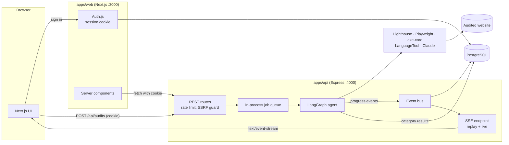
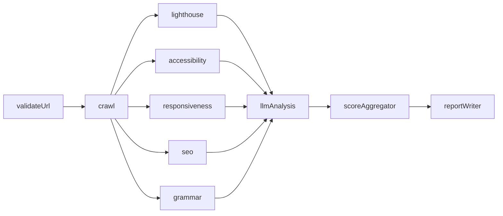

# SiteScope

An agentic website auditor. Sign in, give SiteScope a URL and a little context about the site, and a LangGraph agent audits it across 10 categories, streaming its progress live. When it finishes you get a score for each category, a description of every issue it found, and prioritized fixes with effort estimates.

SiteScope is free for the people who use it. The only running cost is the optional Claude API usage, which is billed to the operator's own Anthropic key.

## What it checks

| Category | How it's measured |
|---|---|
| Performance | Lighthouse on mobile and desktop: LCP, CLS, TBT, FCP, Speed Index |
| Device-wise performance | Mobile vs desktop Lighthouse runs, compared metric by metric |
| Slow-loading items | Lighthouse diagnostics: render-blocking requests, oversized images, unused JS/CSS, third parties |
| Accessibility | axe-core (WCAG 2.2 rules) in Playwright, plus Lighthouse accessibility |
| Responsiveness | Playwright at 375, 768, 1024 and 1440px: horizontal overflow, tap targets, tiny text, viewport meta, and a Claude review of the screenshots |
| SEO | Lighthouse SEO plus 11 crawl checks: title, meta description, H1, heading order, canonical, `lang`, Open Graph, alt text, duplicate titles, robots.txt, sitemap |
| AEO | Question-style headings, FAQ/HowTo structured data and answer blocks, judged by Claude |
| GEO | Entity clarity, citations, authorship and freshness signals, structured data and llms.txt, judged by Claude |
| Grammar | LanguageTool, with Claude filtering out false positives (names, jargon, UI text) |
| Features to add | Claude compares the site with what similar sites for the same audience offer |

The overall score is a weighted average with a letter grade (A ≥ 90, B ≥ 80, C ≥ 70, D ≥ 60, otherwise F). Categories that couldn't be measured are left out, and the remaining weights are re-normalized. Weights, category definitions and tool descriptions all live in one file, [`packages/shared/src/config/categories.ts`](packages/shared/src/config/categories.ts), so tooltips, reports and scoring stay consistent.

## Tech stack

- **Monorepo:** pnpm workspaces, TypeScript (strict) everywhere
- **Web** (`apps/web`): Next.js 16 (App Router), React 19, Tailwind CSS 4, shadcn/ui (Radix), Motion, Lucide icons
- **API** (`apps/api`): Express 5, LangGraph.js, `@langchain/anthropic` (Claude Sonnet 5.5), Lighthouse 13 with chrome-launcher, Playwright with axe-core, LanguageTool
- **Shared** (`packages/shared`): Zod schemas and types for results and events, category config, scoring
- **Database** (`packages/db`): PostgreSQL 17 (Docker) and Prisma 7
- **Auth:** Auth.js v5 (email/password, plus Google OAuth when configured). The API verifies the same session cookie.

## Architecture



### The agent



- **validateUrl** re-checks the SSRF guard and confirms the site responds. This is the only step whose failure stops the audit.
- **crawl** renders the homepage and up to 4 key internal pages in headless Chromium, and fetches robots.txt, the sitemap and llms.txt.
- **lighthouse, accessibility, responsiveness, seo, grammar** run in parallel. Lighthouse runs are serialized through a single queue (overlapping runs skew timings) and cached per URL for 15 minutes. The accessibility and SEO nodes reuse the same runs.
- **llmAnalysis** makes one structured Claude call that covers AEO, GEO, missing features and UI/UX ideas.
- **scoreAggregator** and **reportWriter** compute the overall score and summarize the run.

Every node emits structured progress events (`node_started`, `tool_called`, `finding`, `node_completed`, `error`, plus `category_result`, `screenshot`, `audit_completed` and `audit_failed`). Each node has its own timeout. If a tool fails, that node's categories are saved as failed with the reason, and the audit carries on with what it could measure.

### Request flow

1. `POST /api/audits` validates the input, applies the per-user rate limit and the SSRF guard, saves the audit, queues it and returns `202` straight away.
2. The browser opens `GET /api/audits/:id/events` (Server-Sent Events). Stored events are replayed after `Last-Event-ID`, then new ones stream live, so reloading mid-run picks up where it left off.
3. When the run finishes, the page reloads its data from the server and shows the results. A finished audit opens the same view: pipeline, screenshots and the full activity log, alongside score cards with **How to fix?** details.

### Security notes

- **SSRF guard:** only http(s) on ports 80/443 is allowed, with no embedded credentials. Every address a hostname resolves to must be public, which blocks loopback, private, link-local, CGNAT and cloud-metadata ranges. Server-side fetches re-check each redirect hop, and the Playwright browser blocks any request (including subresources) to a private host.
- **Known gap:** Lighthouse drives Chrome directly, so a redirect to a private address *during* a Lighthouse run isn't intercepted. The URL is validated before the run starts.
- **Untrusted site text:** scraped text is sent to Claude as untrusted data, with instructions to ignore anything inside it that reads like a command.
- **Ownership checks:** audits, events and screenshots are only served to the audit's owner.

## Getting started

### Prerequisites

- **Node.js 24+**
- **pnpm**, via Corepack: run `corepack enable` (on Windows this may need an administrator shell)
- **Docker** (for PostgreSQL)
- **Google Chrome** installed locally (used by Lighthouse). If it isn't found automatically, set `CHROME_PATH`.

### Setup

```bash
pnpm install                              # also generates the Prisma client
pnpm exec playwright install chromium     # browser for crawling, axe-core and screenshots
cp .env.example .env                      # then edit .env (see below)
pnpm db:up                                # start PostgreSQL in Docker (host port 5433)
pnpm db:migrate                           # create the database tables
pnpm dev                                  # web on http://localhost:3000, API on http://localhost:4000
```

Open http://localhost:3000, create an account and start an audit.

### Environment variables

All packages read a single `.env` at the repo root.

| Variable | Required | Purpose |
|---|---|---|
| `DATABASE_URL` | yes | PostgreSQL connection string. The default matches `docker-compose.yml`. |
| `AUTH_SECRET` | yes | Secret for Auth.js sessions; the API uses it too. Generate with `npx auth secret`. |
| `AUTH_URL` | recommended | Public URL of the web app (`http://localhost:3000` in development). Required in production. |
| `AUTH_GOOGLE_ID`, `AUTH_GOOGLE_SECRET` | no | Enable "Continue with Google". Redirect URI: `http://localhost:3000/api/auth/callback/google` |
| `ANTHROPIC_API_KEY` | no | Enables the Claude-powered analysis. Without it, AEO, GEO, features and UI ideas show as *not analysed*, and grammar is marked *partial*. |
| `CLAUDE_MODEL` | no | Defaults to `claude-sonnet-5-5` |
| `API_PORT` | no | API port (default `4000`) |
| `NEXT_PUBLIC_API_URL` | no | Where the browser reaches the API (default `http://localhost:4000`) |
| `API_PUBLIC_URL` | no | Base URL for screenshot links (defaults to `http://localhost:API_PORT`) |
| `WEB_ORIGIN` | no | Origin allowed by the API's CORS policy (default `http://localhost:3000`) |
| `AUDIT_RATE_LIMIT_PER_HOUR` | no | Audits each user can start per rolling hour (default `5`) |
| `AUDIT_MOCK_MODE` | no | `true` replays a scripted, roughly 25-second audit with no real tools. Useful for UI work. |
| `LIGHTHOUSE_CACHE_TTL_MS` | no | How long Lighthouse results are reused (default 15 minutes) |
| `LANGUAGETOOL_URL` | no | LanguageTool endpoint. Defaults to the free public API (about 20 requests per minute). |
| `CHROME_PATH` | no | Path to Chrome, if chrome-launcher can't find it |

The API reads `.env` only at startup. Restart `pnpm dev` after changing it.

### Costs

Everything except Claude is free to run: Lighthouse, Playwright, axe-core, the LanguageTool public API, local PostgreSQL and Auth.js. With `ANTHROPIC_API_KEY` set, each audit makes up to 3 Claude calls (content analysis, grammar filtering and the screenshot review), billed to that key. The per-user rate limit caps how many audits each person can start per hour.

## Scripts

| Command | What it does |
|---|---|
| `pnpm dev` | Runs the web app and the API in watch mode |
| `pnpm typecheck` | Type-checks every package |
| `pnpm db:up` | Starts PostgreSQL in Docker |
| `pnpm db:migrate` | Applies Prisma migrations (and creates new ones in development) |
| `pnpm db:generate` | Regenerates the Prisma client |
| `pnpm --filter @sitescope/web lint` | Lints the web app |

## API

All routes except `/health` require the Auth.js session cookie.

| Method | Path | Description |
|---|---|---|
| `GET` | `/health` | Liveness check |
| `POST` | `/api/audits` | `{ url, context }` → `202 { auditId }`. Returns `400` for invalid or private URLs and `429` (with `Retry-After`) when rate limited. |
| `GET` | `/api/audits` | The current user's audits, newest first |
| `GET` | `/api/audits/:id` | Full audit: category results, issues, fixes, UI ideas, screenshots |
| `GET` | `/api/audits/:id/events` | SSE stream. Replays events after `Last-Event-ID`, then streams live, and closes after `audit_completed` or `audit_failed`. |
| `POST` | `/api/audits/:id/rerun` | Starts a new audit with the same URL and context |
| `GET` | `/api/audits/:id/screenshots/:name` | Screenshot image (owner only) |

## Project structure

```
apps/
  web/                 Next.js app: auth, dashboard, new-audit form, live and results view
    components/agent/    pipeline, activity feed, category chips, screenshots, illustration
    components/results/  score cards, "How to fix?" dialog, gauges, ideas
  api/                 Express API and LangGraph agent
    src/agent/           graph, state, nodes, tools (Lighthouse, browser, LanguageTool, Claude)
    src/agent/categories/  pure scoring: raw measurements → score, issues, fixes
    src/events/          event numbering, persistence and pub/sub for SSE
    src/jobs/            in-process queue and result saving
    src/security/        SSRF guard
packages/
  shared/              Zod schemas, category config (weights and definitions), scoring
  db/                  Prisma schema, migrations and client
```

## Status and limitations

**Built**
- Authentication, the dashboard and the new-audit form
- The live "agent at work" screen
- The real agent with every tool
- Claude analysis nodes (needs an API key)
- Results with score cards, issue descriptions and the **How to fix?** dialog

**Not yet built**
- PDF export
- A dark-mode toggle (dark color tokens already exist)
- Automated tests: Jest for API logic, Playwright for the main user flow

**Limitations**
- **Jobs run in memory:** an audit that is running when the API restarts is marked as failed and needs re-running.
- **Screenshots pile up:** they're stored on disk under `apps/api/storage/`, and nothing cleans them up yet.
- **LanguageTool rate limits:** the free public API is rate-limited, so very frequent audits may see grammar checks fail. That category is then marked failed, and the rest of the audit continues.
